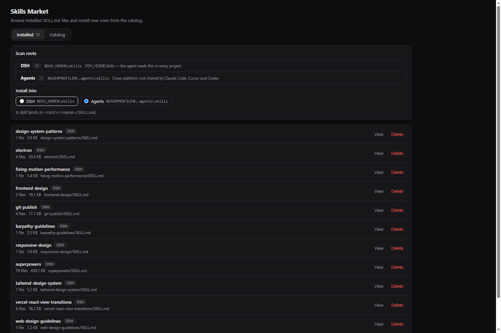

[English](README.md) · [Русский](README.ru.md)

# dsh-skills-market

A plugin for the [DeepSeek Harness](https://github.com/deepseek-ai) Web UI that lists the
`SKILL.md` files this machine already has and installs new ones from a curated registry,
[SkillsMP](https://skillsmp.com), [skills.sh](https://skills.sh) and GitHub.

The agent skill format is cross-platform — the same `SKILL.md` is read by DSH, Claude Code,
Cursor and Codex — so `~/.agents/skills` is treated as a first-class install target rather
than an afterthought.



## How it works

The plugin is an npm package with two halves. `index.js` runs in Node as a Cordis plugin and
owns the filesystem and the network; `client.js` runs in the browser and owns the page. They
meet at a JSON API under `/dsh-skills-market`.

| Route | Method | Answers |
| --- | --- | --- |
| `/state` | GET | Scanned roots, installed skills, resolved config |
| `/catalog` | GET | Curated cards, optionally merged with live search results |
| `/skill` | GET | One installed skill: its `SKILL.md` and its file list |
| `/search` | GET | Live search across the enabled sources |
| `/install` | POST | Fetch a skill and write it to a root |
| `/remove` | POST | Delete an installed skill directory |

Every response is `{ ok: true | false, ... }`. Request bodies are capped at
`MAX_BODY_BYTES = 1_000_000`; a larger one is answered `413`.

### Skill roots

`dsh-skill-filesystem` reads four roots. This plugin scans all four and installs into two.

| Root id | Path | Scanned | Installable |
| --- | --- | --- | --- |
| `user-dsh` | `$DSH_HOME/skills` | yes | yes |
| `user-agents` | `$DSH_AGENTS_HOME/skills`, else `~/.agents/skills` | yes | yes |
| `project-dsh` | `<projectRoot>/.dsh/skills` | yes | no |
| `project-agents` | `<projectRoot>/.agents/skills` | yes | no |

`$DSH_HOME` is **not** assumed to be `~/.dsh`. A managed install usually points it somewhere
else, and a market that wrote to a literal `~/.dsh` would install skills the agent never
reads. The page prints the resolved absolute path of every root it scanned, so the two can be
compared without guessing.

Both layouts are recognised, matching what `dsh-skill-filesystem` accepts:

| Layout | Example |
| --- | --- |
| Directory bundle | `<root>/<name>/SKILL.md` |
| Flat file | `<root>/<name>.md` |

### Installing

1. Fetch the entry point — a `raw.githubusercontent.com` URL, or a GitHub directory walked
   through the contents API.
2. Derive the skill name from the frontmatter `name:`, then from the URL, then from the title.
3. Create `<root>/<name>/` and write the bundle into it.
4. Write `SKILL.md` **last**.

Step 4 is what makes a failed install safe, and it is explained under *Why it is built this
way*.

A GitHub-sourced card is fetched as a whole bundle rather than a lone file, because a
`SKILL.md` that references `rules/` or `references/` is broken without them. The walk is
recursive but bounded by `MAX_BUNDLE_DEPTH = 2`, by `maxSiblingFiles`, and by a byte budget.

### The curated registry

`data/catalog.json` holds 24 cards, every one of them a real `SKILL.md` that was fetched and
read while the card was written. `scripts/build-curated.mjs` validates the file and generates
`lib/curated-data.js`; the generated module is not edited by hand.

| Repository | Cards | Categories |
| --- | --- | --- |
| `anthropics/skills` | 6 | frontend, layout, prompt, docs, testing |
| `vercel-labs/agent-skills` | 4 | frontend, layout |
| `wshobson/agents` | 9 | frontend, layout, debug, prompt, docs, testing, git |
| `obra/superpowers` | 5 | debug, prompt, testing, git |

Category spread: frontend 5, layout 5, debug 4, prompt 3, docs 3, testing 2, git 2.

The generator **refuses to build a card whose `raw` URL does not agree with its
`repo`/`branch`/`path`**. A typo therefore fails the build instead of reaching the Install
button, where it would surface as a 404 in someone else's browser.

### Live sources

| Source | Endpoint | Credential | State |
| --- | --- | --- | --- |
| `skillsmp` | `https://skillsmp.com/api/v1/skills/search` | none, optional key | enabled by default |
| `skillssh` | `https://skills.sh/api/v1/skills/*` | Vercel OIDC token | dark without a token |
| `github` | GitHub code search, `filename:SKILL.md` | personal access token | opt-in |

`DEFAULT_LIVE_SOURCES = ['skillsmp']` — the one adapter that needs no credential. A default
that always painted an authorization error would read as a bug rather than as a setting.

Two providers were rejected on evidence, not on taste:

- **AgenticSkills is not shipped.** `agenticskills.com` is a parked domain: it redirects
  cross-origin to a domain resale marketplace, and both `/api/skills` and `/api/v1/skills`
  answer `404`. There is no JSON API and no card markup to scrape, so an adapter would be a
  permanently broken shelf. A test asserts the adapter is absent.
- **skills.sh ships disabled.** Every `/api/v1/*` route answers
  `401 {"error":"authentication_required"}` and requires a Vercel OIDC bearer token. The
  response shape behind that wall could not be confirmed, so the mapping is deliberately
  tolerant of missing fields.

SkillsMP's API shape is confirmed — `{ success, data: { skills, pagination, filters }, meta }`
with items carrying `id`, `name`, `author`, `description`, `contentLanguage`, `githubUrl`,
`skillUrl`, `stars`, `updatedAt`. Its **search relevance is broken on the provider's side**:
`q=react` and `q=tailwind` both returned unrelated skills. It is usable as a source, not as a
browsable shelf, which is why the curated registry exists.

A source that hits its limit is reported with its **cooldown**, not only its status code.
SkillsMP answers an exhausted daily quota with `429` and `Retry-After: 78860`; the page turns
that into a live countdown — *retry in 21 h 49 min* — because `429` on its own does not tell a
reader whether to wait a second or a day. When the window runs out, the row asks for one
refresh. A host that names no window gets no clock: a countdown nothing backs is worse than
the bare code.

## What the composition changed

The page is registered **twice**, and the two seats do not agree on who provides the scroll
container.

| Seat | Registration | Who scrolls |
| --- | --- | --- |
| Sidebar panel | `sidebar.panellist` (order 1) + keyed `main` (`key: 'skills-market'`) | the page itself |
| Settings | `settings.section` (id `skills-market`, order 46) | the host's options box |

The sidebar frame is `height:100%; overflow:hidden` and offers no scroller at all, so a page
in that seat that does not scroll itself is clipped and cannot be read past the fold. The
Settings dialog does scroll — `.VOzbGW_options { flex:1; min-height:0; overflow-y:auto }`. The
page therefore carries `height:100%; overflow-y:auto` and its own padding, mirroring what
`dsh-client-ui-plugin-manager` does for the Plugins page. `height:100%` resolves against
whichever box it lands in, which keeps it to exactly one scrollbar in both seats.

The page also keeps one error slot **per tab**. The alert renders above the tab switch, so an
unscoped failure — a catalog fetch that died, say — would paint over the installed inventory, a
tab that had nothing to do with it and offers no way to act on it.

Two lines here are load-bearing rather than cosmetic:

- **`sidebar.panellist`'s `id` must equal the `main` panel's `key`.** They are two halves of
  one registration; if they disagree, the sidebar row renders and opens nothing.
- **The `max-width` cap sits on the inner wrapper, not on the scroll container.** A cap on the
  scroller parks its scrollbar in the middle of a wide panel instead of at the panel edge.

`order: 46` places the section directly under the MCP market (`order: 45`).

## Install

The plugin has no dependencies. Its host half imports `node:*` and nothing else, which is
required rather than tidy: a bundle installed into a profile resolves bare specifiers from its
own directory and does not see the harness's `node_modules`.

```sh
# 1. Put this checkout somewhere stable, then add it to the profile.
cd "$DSH_PROFILE_DIR"

# package.json: add to "dependencies"
#   "@local/dsh-skills-market": "link:<absolute path to this checkout>"
# package.json: add to "dsh.profile.bundles"
#   "@local/dsh-skills-market"

# 2. Materialise the link.
pnpm install

# 3. Restart the web server.
dsh web --port 3080
```

Editing `client.js` or `index.js` reaches the browser **only after a restart**. The host caches
the bundle bytes in-process and derives the artifact revision from the file's mtime/ctime/size;
the HMR watch roots are opt-in and empty by default (`dsh-base/cordis.patch.yml` registers `hmr`
with `config: { root: [] }`). Editing a loader entry's config does not re-activate the plugin
either — Cordis merges the config into the live instance. Reloading the page serves the old
bundle.

## Secrets

Nothing is stored in this repository, and no key is required to use the plugin.

| Setting | Effect when empty |
| --- | --- |
| `githubToken` | GitHub code search is unavailable; the anonymous API rate limit applies |
| `skillsmpKey` | anonymous access, documented by the provider as 50 requests a day |
| `skillsshToken` | the `skillssh` source answers `401` and stays dark |

Tokens are read from the plugin's own config and sent as `Authorization: Bearer <token>` on
the requests that need them. This plugin never writes them to disk and never logs them.

## Settings

| Control | Accepted values | Default |
| --- | --- | --- |
| `enabled` | boolean | `true` |
| `defaultTarget` | `user-dsh`, `user-agents` | `user-dsh` |
| `dshHome` | absolute path | `$DSH_HOME`, then `~/.dsh` |
| `agentsHome` | absolute path | `$DSH_AGENTS_HOME`, then `~/.agents` |
| `projectRoot` | absolute path | empty — user roots only |
| `curatedUrl` | HTTPS URL of a JSON card array | empty — bundled registry |
| `liveSources` | comma-separated `skillsmp`, `skillssh`, `github` | `skillsmp` |
| `githubToken` | string | empty |
| `skillsmpKey` | string | empty |
| `skillsshToken` | string | empty |
| `allowRemote` | boolean | `false` |
| `allowInsecure` | boolean | `false` |
| `maxSiblingFiles` | integer 0–200 | `40` |

`allowRemote` is off by default because `/install` and `/remove` write to the filesystem. With
it off, both routes answer `403` to any address that is not loopback.

`allowInsecure` is off by default. With it off, `assertFetchableUrl` accepts `https:` only and
refuses loopback, link-local and private ranges — `127.`, `10.`, `192.168.`, `172.16`–`172.31`,
`169.254.`, `localhost`, `::1`. Without that check the market would be a server-side request
forgery primitive pointed at whatever the host can reach.

## Tuning

| Variable | Default | Meaning |
| --- | --- | --- |
| `DSH_HOME` | `~/.dsh` | Resolves the `user-dsh` root |
| `DSH_AGENTS_HOME` | `~/.agents` | Resolves the `user-agents` root |
| `DSH_WEB_URL` | `http://127.0.0.1:3080` | Used by `scripts/preview.mjs` to find the live server |

Fetch limits, overridable through the install API rather than the settings UI:

| Constant | Value | Meaning |
| --- | --- | --- |
| `DEFAULT_MAX_FILE_BYTES` | `2 * 1024 * 1024` | Largest single file an install accepts |
| `DEFAULT_TIMEOUT_MS` | `20_000` | Per-request fetch timeout |
| `MAX_BUNDLE_DEPTH` | `2` | Directory levels walked below the skill root |
| `MAX_BODY_BYTES` | `1_000_000` | Largest request body the HTTP API reads |

## Tests

```sh
npm test
```

which runs:

```sh
node --test --test-timeout=30000 test/market.test.mjs test/client.test.mjs
```

43 tests, no network access. `test/market.test.mjs` covers the root graph, `isSafeSkillName`,
frontmatter parsing, both on-disk layouts, read and remove, `writeSkill` — including its refusal
to write without a `SKILL.md` and its refusal of path traversal — `resolveSource` for both raw
and GitHub sources against a fake fetch, the registry and `mergeCurated`, the source adapters,
and the HTTP routes through fake `req`/`res` objects. `test/client.test.mjs` covers the client
half's contract and the element tree the page builds.

## Cost

The page costs nothing to open. The bundled registry is generated at build time, so rendering
the catalog makes no network request.

Live search and install do reach the network, subject to the provider's limits:

| Provider | Limit | Provenance |
| --- | --- | --- |
| `raw.githubusercontent.com` | none documented | — |
| GitHub API | 60 requests/hour per IP anonymous, 5000 with a token | documented by GitHub |
| SkillsMP | 50 requests/day anonymous | as surfaced in the plugin's own `skillsmpKey` setting |
| skills.sh | every `/api/v1/*` route requires a token | measured: `401 authentication_required` |

## Failure classes

| Symptom | Cause | What to do |
| --- | --- | --- |
| `429 Too Many Requests` | the source's quota is exhausted; SkillsMP's is 50 requests a day | wait out the countdown shown on the row, or set a key for that source |
| `401 {"error":"authentication_required"}` | `skillssh` enabled without `skillsshToken` | set the token, or drop `skillssh` from `liveSources` |
| `403` on `/install` or `/remove` | request from a non-loopback address with `allowRemote: false` | reach the UI on loopback, or set `allowRemote` deliberately |
| `413` | request body over `MAX_BODY_BYTES` | send a smaller body |
| `response too large` | file over `DEFAULT_MAX_FILE_BYTES` | raise the limit, or install the skill by hand |
| `unsafe skill name` | name failed `isSafeSkillName`, or resolved outside the root | rename the skill |
| Install succeeds but the agent does not see the skill | the harness loads skills at session start | open a New Session |
| Installed skill never appears in the list | written to a `DSH_HOME` the harness does not read | compare the resolved root path printed on the page |
| Sidebar list is clipped and will not scroll | the page lost its own `height:100%; overflow-y:auto` | see *What the composition changed* |

## Switching back

Remove the loader entry and the dependency from the profile's `package.json`, run
`pnpm install`, and restart `dsh web`. The plugin writes nothing outside the skill roots, so
nothing else needs cleaning up.

Skills it installed stay on disk. Remove them from the page first if you want them gone, or
delete the directories under `$DSH_HOME/skills` and `$DSH_AGENTS_HOME/skills` directly.

## Why it is built this way

The decision worth explaining is the `SKILL.md`-last write order.

An install is not atomic: it fetches several files and writes them one at a time. The obvious
order — write the entry point first, then the files it references — leaves a directory that
looks like a working skill at exactly the moment it is least working. If the fetch dies
partway, the loader sees a valid `SKILL.md`, loads the skill, and the skill then fails on a
missing `rules/` file at the point of use, far from the cause.

Writing the entry point last inverts that. A directory without `SKILL.md` is not a skill as far
as `dsh-skill-filesystem` is concerned, so a half-written bundle is invisible rather than
broken — and an invisible directory is something a retry can overwrite.

The second decision is smaller but has the same shape: the curated registry is a **build-time
snapshot, not a live query**. Search relevance at the providers is outside this plugin's
control — SkillsMP's is measurably broken — and a catalog that silently returns unrelated
skills teaches the reader to distrust the whole page. A card that was fetched and read once, at
build time, is a claim this repository can stand behind.

## Development

`scripts/preview.mjs` renders the real component to a standalone HTML file, so the layout can
be inspected without a running harness. It loads the factory exactly as the host does, captures
the stylesheet the page injects, serializes the element tree the component returned, and pulls
live `/state` and `/catalog` payloads when the server answers. Absolute paths are rewritten to
`%DSH_HOME%` / `%USERPROFILE%` so a committed screenshot carries no machine paths.

```sh
node scripts/preview.mjs catalog     # or: installed
node scripts/preview.mjs installed --probe
```

`--probe` overlays a banner reporting `clientHeight`, `scrollHeight` and `SCROLLABLE`. A still
image cannot distinguish a clipped box from a scrollable one, so without the banner a broken
scroll container and a working one produce the same screenshot.

The host's `--dsw-alias-*` tokens are not defined outside the harness, so the preview stands in
a dark approximation of them. Only the values differ; every rule under test is the shipped one.
The locale binding is real, though: binding `t` to the identity function would print key names
— `secCurated`, `unitHour` — into the screenshot, which a reader would take for the shipped UI.

```sh
msedge --headless=new --disable-gpu --window-size=1500,1000 \
  --screenshot="<absolute path>.png" "file:///<absolute path>.html"
```

The `--screenshot` path must be absolute; a relative one fails with an access error.

## License

MIT — see [LICENSE](LICENSE).
